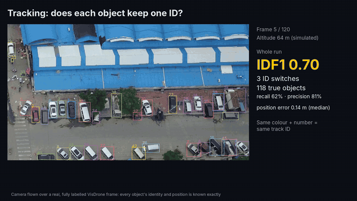
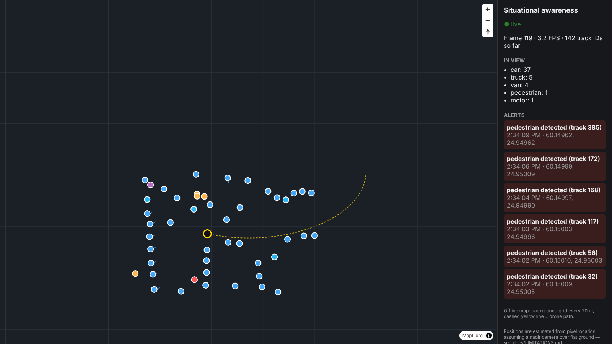
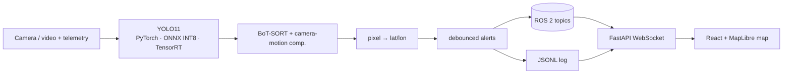

# Edge AI for Real-Time Situational Awareness from Drones

[](https://github.com/mustafarkhan/edge-situational-awareness/actions/workflows/ci.yml)
[](https://github.com/mustafarkhan/edge-situational-awareness/actions/workflows/ros2.yml)
[](LICENSE)

Detecting, tracking and geolocating people and vehicles in drone video, built for embedded
deployment (NVIDIA Jetson). Every number below was measured on public data, and each one links to
the script and results file that produced it.



🎬 **[Demo video (2 min)](docs/video/demo_video.mp4)**, rendered only from real outputs by `docs/video/make_video.py`.

> **Status (October 2026).** Data analysis, detector experiments, fine-tuning, tracking,
> geolocation, INT8 quantisation, failure analysis and the live map are done, measured on CPU; the ROS 2
> node is tested end to end on ROS 2 Humble in CI.
> **Still to come:** TensorRT on a Jetson Orin Nano (speed, watts, joules per frame) with
> [one command](benchmarks/run_on_jetson.sh), then real continuous footage and maritime data.

## Results at a glance

| Question | Answer (measured) |
|---|---|
| How small are objects in drone views? | At YOLO's 640 px input the **median object is 11 px** across; **92%** are "small" (< 32 px) |
| Does an off-the-shelf detector cope? | No. COCO-pretrained YOLO11n: AP **0.041** on small objects, 0.58 on large ones |
| What helps most? | 1280 px input and a short fine-tune: small-object AP **0.041 → 0.182** (4.4×), beating a 3× larger pretrained model at half the time |
| Is sliced inference (SAHI) worth it here? | Not on these images: 0.110 at 882 ms vs 0.124 at 317 ms for plain 1280 px input |
| Do objects keep their IDs when the drone moves fast? | Only with camera-motion compensation: IDF1 **0.33 → 0.57**, ID switches **244 → 77** |
| Where do position errors come from? | Ignoring a **10° gimbal tilt costs 11.8 m**, more than a 5 m GPS error |
| Does INT8 work? | Quantising everything gives **zero detections**; keeping the head in FP32 costs **5%** small-object AP for **20%** less time and a **66%** smaller model |
| Where does it still fail? | Objects under 8 px (**10%** found), heavy occlusion (**23%**), night (precision **70% → 44%**) |

## 1. The data

VisDrone2019-DET validation set: 548 images, 38,759 labelled objects
(`python data/analyse_dataset.py`).

| model input | median object size | under 16 px | "small" (< 32 px, COCO definition) |
|---|---|---|---|
| 640 px (YOLO default) | **11 px** | **70%** | **92%** |
| 1280 px | 22 px | 31% | 70% |

The metric that matters is **AP on small objects**. Headline mAP hides the problem.

## 2. Detection accuracy

All rows: 548 val images; classes mapped to person / two-wheeler / vehicle so COCO-pretrained and
fine-tuned models are scored the same way; COCO AP at IoU 0.50:0.95; maxDets 500.
Time = median end-to-end ms per image on a **2-vCPU cloud VM without GPU** (useful to compare
rows; repeated runs vary by about ±10%; not Jetson numbers).
Source: [`benchmarks/results/zeroshot.csv`](benchmarks/results/zeroshot.csv), script `training/evaluate_zeroshot.py`.

| model | weights | input | AP50 | AP | **AP small** | AP large | CPU ms |
|---|---|---|---|---|---|---|---|
| YOLO11n | COCO | 640 | 0.200 | 0.108 | 0.041 | 0.576 | 86 |
| YOLO11s | COCO | 640 | 0.280 | 0.153 | 0.075 | 0.685 | 200 |
| YOLO11n | COCO | 1280 | 0.356 | 0.198 | 0.124 | 0.684 | 317 |
| YOLO11s | COCO | 1280 | 0.433 | 0.244 | 0.164 | 0.750 | 634 |
| YOLO11n + SAHI (640 px tiles) | COCO | 640 | 0.344 | 0.180 | 0.110 | 0.594 | 882 |
| YOLO11n | fine-tuned, 1 epoch | 640 | 0.266 | 0.132 | 0.057 | 0.435 | 79 |
| YOLO11n | fine-tuned, 2 epochs | 640 | 0.316 | 0.161 | 0.079 | 0.483 | 80 |
| YOLO11n | fine-tuned, 2 epochs | 1280 | 0.448 | 0.238 | 0.169 | 0.354 | 319 |
| YOLO11n | fine-tuned, 3 epochs | 640 | 0.334 | 0.173 | 0.087 | 0.527 | 76 |
| **YOLO11n** | **fine-tuned, 3 epochs** | **1280** | **0.469** | **0.253** | **0.182** | 0.378 | 295 |

- **Resolution beats model size** for small objects: YOLO11n at 1280 beats YOLO11s at 640.
- **SAHI** nearly triples small-object AP but costs 10× the time of 640 px inference. VisDrone val frames are
  only 960–1920 px wide, so 640 px tiles add little over a 1280 px input. It should matter more on 4K footage
  (a hypothesis, not yet tested).
- **Fine-tuning** (3 CPU epochs, ~50 min each) gave the biggest gain, but large-object AP fell from 0.58 to 0.38: the
  model specialised in high-altitude views (see the near-ground failure in §6). A longer GPU run is the next step.
- Held-out check: two training sequences (9999951, 9999955) were removed **before** training. On 21 frames from one of them
  the model found **448 of 836** labelled objects (54%, IoU ≥ 0.5, confidence 0.25).

## 3. Tracking under camera motion

**Method.** No continuous drone video with per-object identities was reachable from the build machine, so
[`tools/sim_flight.py`](tools/sim_flight.py) flies a simulated camera (960×540, altitude 57–69 m, 70° lens)
in an ellipse over one real, fully labelled, near-vertical VisDrone frame (186 objects). Every object's
identity and ground position is therefore known **exactly**: ID switches and position error can be scored
precisely, and camera speed becomes a dial. Same fine-tuned detector (1280 px, conf 0.1) for every run;
only the tracker changes. Scored with `motmetrics` (IoU ≥ 0.5).
Source: [`benchmarks/results/tracking.csv`](benchmarks/results/tracking.csv).

| camera speed | tracker | IDF1 | ID switches | MOTA | recall | precision |
|---|---|---|---|---|---|---|
| slow (0.6 m/frame) | ByteTrack | 0.657 | 15 | 0.425 | 56% | 81% |
| slow | BoT-SORT, motion compensation **off** | 0.678 | 7 | 0.457 | 58% | 83% |
| slow | BoT-SORT, motion compensation **on** | **0.700** | **3** | 0.474 | 62% | 81% |
| fast (2.4 m/frame) | ByteTrack | 0.331 | 244 | 0.244 | 31% | 89% |
| fast | BoT-SORT, motion compensation **off** | 0.343 | 301 | 0.267 | 33% | 93% |
| fast | BoT-SORT, motion compensation **on** | **0.566** | **77** | **0.493** | **59%** | 88% |

- The two BoT-SORT rows differ in one setting (`gmc_method`, see `configs/trackers/botsort_nogmc.yaml`), so the
  gap is the effect of **camera-motion compensation**. When the drone moves fast it decides whether tracking works at all.
- Without it, recall also halves at speed. Trackers only report *confirmed* tracks; when every object jumps 20+ px
  per frame, tracks keep breaking and the detections behind them are hidden.
- **What this test cannot show:** objects moving on their own, real camera geometry (the frame is treated as a
  straight-down photo), blur, lighting change. Real footage is the next step.

## 4. Geolocation error budget

[`src/esa/geo.py`](src/esa/geo.py) turns a box centre into latitude/longitude assuming a straight-down camera
over flat ground. On the simulated flight with perfect telemetry the median error is **0.14 m** (that only
checks the code). [`benchmarks/geo_sensitivity.py`](benchmarks/geo_sensitivity.py) then adds one realistic error
at a time to all 7,634 labelled boxes. Tilt is evaluated with a full pinhole-ray / ground-plane intersection.

| error source | median error | 95th pct |
|---|---|---|
| GPS off by 2 m / 5 m | 2.0 m / 5.0 m | 2.0 / 5.0 m |
| altitude reading +5% / +10% | 1.4 m / 2.9 m | 2.3 / 4.6 m |
| compass heading off 2° / 5° | 1.0 m / 2.5 m | 1.6 / 4.0 m |
| **gimbal tilt ignored, 5° / 10° / 20°** | **5.8 m / 11.8 m / 24.2 m** | 6.6 / 13.8 / 30.7 m |

At ~60 m altitude, **the nadir assumption is the biggest error source**. Reading the gimbal angle and doing the
ray intersection is the first thing to fix before real use.

## 5. INT8 quantisation (ONNX Runtime, CPU)

TensorRT needs the Jetson, but the INT8 question (what does 8-bit cost, and where?) can be answered
on CPU. [`export/quantize_onnx.py`](export/quantize_onnx.py): static INT8, QDQ, per-channel weights, calibrated on
128 **train** images (never on evaluation images). Fine-tuned YOLO11n, 1280 px, all 548 val images.
Source: [`benchmarks/results/quantization.csv`](benchmarks/results/quantization.csv).

| model | AP | **AP small** | CPU ms | size |
|---|---|---|---|---|
| PyTorch FP32 | 0.253 | 0.182 | 295 | 5.4 MB (.pt) |
| ONNX FP32 | 0.251 | 0.181 | 251 | 11.1 MB |
| ONNX INT8, everything quantised | **0.000** | **0.000** (no detections at all) | 162 | 3.8 MB |
| ONNX INT8, head post-processing kept FP32 | 0.239 | **0.172** | **201** | **3.7 MB** |

YOLO's last layer concatenates box coordinates (0–1280) with class scores (0–1) into one tensor. A single
8-bit range for both rounds every score to zero. Keeping only the head's post-processing in FP32 (48 nodes;
all convolutions stay INT8) recovers almost all accuracy. Whether TensorRT's INT8 shows the same behaviour is
part of the Jetson run.

## 6. Where it still fails

[`data/failure_analysis.py`](data/failure_analysis.py), fine-tuned model, 1280 px, confidence 0.25, all 548 val images,
using VisDrone's own occlusion labels. "Found" = any box with IoU ≥ 0.5. Overall recall **49.5%**.
Full tables: [`benchmarks/results/failure_analysis.md`](benchmarks/results/failure_analysis.md).

| object size at model input | < 8 px | 8–16 | 16–32 | 32–64 | ≥ 64 px |
|---|---|---|---|---|---|
| recall | **10%** | 26% | 49% | 73% | 87% |

| occlusion | none | partial | heavy |
|---|---|---|---|
| recall | 63% | 42% | **23%** |

| lighting (17 dusk/night images, brightness < 70/255, checked by eye) | recall | precision |
|---|---|---|
| daylight | 49.5% | 70% |
| dusk / night | 48.7% | **44%** |

Night does not hide objects from this model; it makes it **invent** them (duplicate and phantom boxes).
Annotated examples are in [`docs/figures/failures/`](docs/figures/failures/) and described in
[docs/LIMITATIONS.md](docs/LIMITATIONS.md).

## 7. The live map



React + MapLibre fed over a FastAPI WebSocket, replaying the tracking output (`web/`). Static objects stay put
while the drone (yellow) moves; "person" alerts fire only after a track has persisted for 10 frames (6 alerts on
this flight). `?offline=1` draws a 20 m grid instead of map tiles, for field laptops without internet.

## 8. On the Jetson (next)

`WEIGHTS=weights/ft_y11n_ep3.pt bash benchmarks/run_on_jetson.sh` builds TensorRT FP16 and INT8 engines at 640 and
1280 px and records AP_small (same metric as above), FPS, p50/p99 latency, watts, joules per frame and peak temperature.

| model | input | precision | AP small | FPS | p99 ms | W | J/frame | max °C |
|---|---|---|---|---|---|---|---|---|
| YOLO11n fine-tuned | 640 | FP16 | | | | | | |
| YOLO11n fine-tuned | 640 | INT8 | | | | | | |
| YOLO11n fine-tuned | 1280 | FP16 | | | | | | |
| YOLO11n fine-tuned | 1280 | INT8 | | | | | | |

## System



The ROS 2 node (`ros2_ws/`) is **tested end to end in CI** whenever the ROS or shared code changes: the [ROS 2 workflow](.github/workflows/ros2.yml)
installs ROS 2 Humble on a GitHub runner, builds the package with colcon, runs the node on sample images and
checks that `/detections` (standard `vision_msgs`), `/tracks_geo` and `/alerts` are published and that the node
exits cleanly ([`ros2_ws/test_node.sh`](ros2_ws/test_node.sh)). That test caught two real bugs: an abort at
shutdown, and alerts lost by subscribers that connect late. `/alerts` is now latched (transient local, last 10),
so a ground station that joins or reconnects still receives recent alerts.

## Reproduce

```bash
pip install -r requirements-train.txt && pip install -e . && pytest -q        # 9 tests, also run in CI

# data: VisDrone2019-DET train + val
python data/convert_visdrone.py --src /path/to/visdrone --out datasets/visdrone_yolo
# hold out two sequences BEFORE training (see docs/EXPERIMENT_LOG.md), then:
python data/analyse_dataset.py --data configs/datasets/visdrone.yaml --split val --imgsz 640 1280
python training/evaluate_zeroshot.py --model yolo11n.pt --data configs/datasets/visdrone.yaml --imgsz 640 --tag y11n_640
python training/train.py configs/train/vis_y11n_640_cpu.yaml

# everything in sections 2-7 on the fine-tuned model
WEIGHTS=weights/ft_y11n_ep3.pt RAW_ANN=/path/to/VisDrone2019-DET-val/annotations bash scripts/phase2_experiments.sh

# map app (laptop, no ROS)
python web/backend/server.py --replay outputs/track_slow_botsort.jsonl
cd web/frontend && npm install && npm run dev          # open with ?offline=1 if there's no internet
```

The step-by-step course, with the reasoning behind each step: [docs/LAB_GUIDE.md](docs/LAB_GUIDE.md).
Every run and decision, including two bugs and how they were found: [docs/EXPERIMENT_LOG.md](docs/EXPERIMENT_LOG.md).

## Repository layout

```
data/          dataset converters, analysis, failure analysis
training/      train.py (config-driven), evaluate_zeroshot.py (AP_small), evaluate_coco.py
configs/       one YAML per experiment; tracker variants
export/        ONNX + INT8 quantisation (CPU), TensorRT export (Jetson)
benchmarks/    tracking scorer, geolocation sensitivity, Jetson benchmark, results CSVs
tools/         sim_flight.py, detect_video.py (detect + track + geolocate), record_map.py
scripts/       phase2_experiments.sh: every experiment above, in order
ros2_ws/       ROS 2 Humble package + end-to-end test (runs in CI)
web/           FastAPI WebSocket bridge + React/MapLibre map
src/esa/       shared code: geolocation, alerts, tegrastats reader, COCO evaluation
docs/          lab guide, experiment log, limitations, model card, interview prep, demo video
tests/         unit tests
```

## Data

| dataset | used for | terms | citation |
|---|---|---|---|
| VisDrone2019-DET | people, vehicles | Research benchmark; the project's GitHub page states no formal licence (checked 2026-10-09). Treated as research-only; no images or weights derived from it are redistributed here. | Zhu et al., "Detection and Tracking Meet Drones Challenge", IEEE TPAMI 44(11), 2021 |
| SeaDronesSee (planned) | swimmers, boats at sea | to be recorded on download | Varga et al., WACV 2022 |

The figures and demo video show VisDrone imagery for illustration.

## Limitations

CPU measurements only so far; short fine-tune on one dataset; tracking tested on a controlled simulation, not real
continuous video; geolocation assumes a straight-down camera; ROS 2 tested in CI, not yet on the Jetson; not for operational use.
Details and failure images: [docs/LIMITATIONS.md](docs/LIMITATIONS.md).

## Independence

Built on personal hardware and cloud resources, in personal time, using only public datasets and open-source
software. No code, data or know-how from any employer or government work was used.

## Licence

[AGPL-3.0](LICENSE), as required by Ultralytics YOLO. Dataset terms apply separately.
