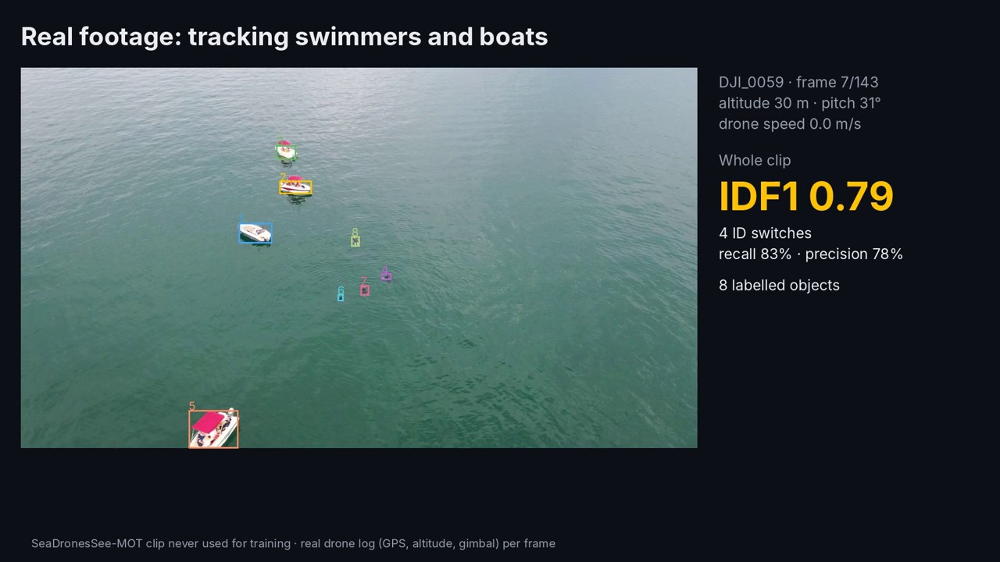
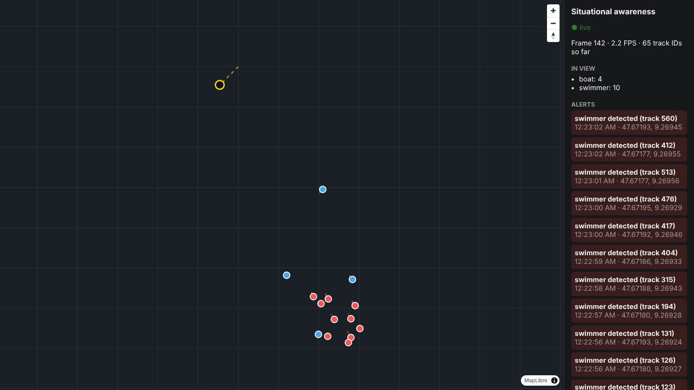
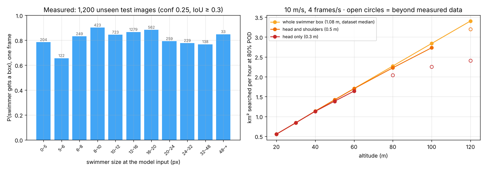
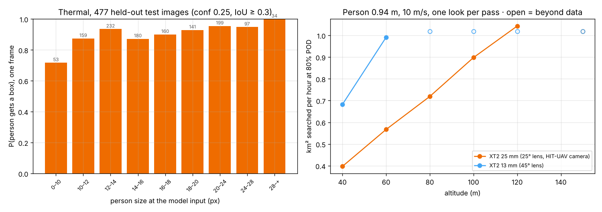
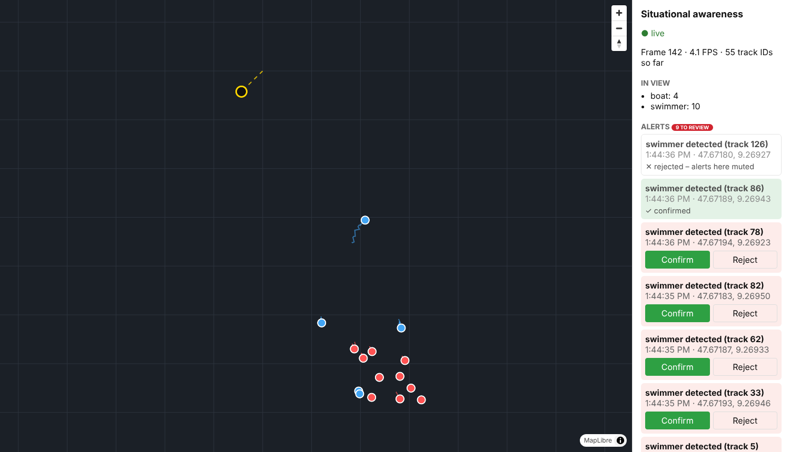
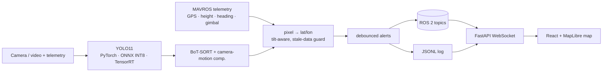

# Edge AI for Real-Time Situational Awareness from Drones

[](https://github.com/mustafarkhan/edge-situational-awareness/actions/workflows/ci.yml)
[](https://github.com/mustafarkhan/edge-situational-awareness/actions/workflows/ros2.yml)
[](https://github.com/mustafarkhan/edge-situational-awareness/actions/workflows/sitl.yml)
[](LICENSE)

Detecting, tracking and geolocating people and vehicles (on land, by day and by thermal camera at night) and
swimmers and boats (at sea) in drone video, planning the search and sending alerts to responders' TAK maps, built for
embedded
deployment (NVIDIA Jetson). Every number below was measured on public data, and each one links to
the script and results file that produced it.


🎬 **[Demo video (3 min)](docs/video/demo_video.mp4)**, rendered only from real outputs by `docs/video/make_video.py`.

> **Status (October 2026, v2).** Land (VisDrone), sea (SeaDronesSee) and thermal (HIT-UAV) modules are done, measured
> on CPU: detection, tracking on real footage, tilt-aware geolocation on real flight logs, INT8, failure analysis,
> **search planning**, an **operator review loop with TAK (ATAK) output**, and **text-prompt search**. The ROS 2 node takes
> live MAVROS telemetry and is tested end to end in CI.
> **v3 (in progress): towards field tests.** Search missions now take off, return and carry a geofence, and are flown
> end to end in ArduPilot's simulator in CI; the ROS node reads RGB and thermal camera topics and reports its own
> health; [docs/DEPLOYMENT.md](docs/DEPLOYMENT.md) is the hardware, rules, safety and field-test plan (§14).
> **Still to come:** TensorRT on a Jetson Orin Nano (speed, watts, joules per frame) with
> [one command](benchmarks/run_on_jetson.sh).

## Results at a glance

| Question | Answer (measured) |
|---|---|
| How small are objects in drone views? | At YOLO's 640 px input the **median object is 11 px** across; **92%** are "small" (< 32 px) |
| Does an off-the-shelf detector cope? | No. COCO-pretrained YOLO11n: AP **0.041** on small objects, 0.58 on large ones |
| What helps most? | 1280 px input and a short fine-tune: small-object AP **0.041 → 0.182** (4.4×), beating a 3× larger pretrained model at half the time |
| Is sliced inference (SAHI) worth it here? | Not on these images: 0.110 at 882 ms vs 0.124 at 317 ms for plain 1280 px input |
| Do objects keep their IDs when the drone moves fast? | Only with camera-motion compensation: IDF1 **0.33 → 0.57**, ID switches **244 → 77** |
| Where do position errors come from? | Ignoring a **10° gimbal tilt costs 11.8 m**, more than a 5 m GPS error |
| Does INT8 work? | Quantising everything gives **zero detections**; keeping the head in FP32 costs **5%** small-object AP for **20%** less time and a **66%** smaller model |
| Where does it still fail? | Objects under 8 px (**10%** found), heavy occlusion (**23%**), night (precision **70% → 44%**) |
| **At sea:** does the land recipe transfer? | Yes. Swimmer AP **0.027 → 0.185** (COCO 640 → fine-tuned 1280); boats 0.155 → 0.503 |
| Can the official sea validation split be trusted? | No. It shares videos with train and **inflates swimmer AP by ~50%** (0.185 → 0.295), measured against a control |
| Does tracking hold on real sea footage? | IDF1 **0.50–0.79** on 4 real clips; GMC makes no difference at these slow camera speeds (as the simulation predicts) |
| **v2:** how high should a search drone fly? | At sea by day: ~5× more sea per hour at 100 m than at 20 m, 0.95 detection per pass, ~1 frame/s is enough. On land at night (thermal): ~1 km²/h at 120 m, and the lens choice matters as much as altitude (§10) |
| **v2:** can operators cope with the alerts? | Spatial de-duplication cuts alerts 45% (33 → 18) without losing a swimmer; alerts go to ATAK via Cursor on Target (§11) |
| **v2:** can text prompts replace training? | No: a 4-epoch fine-tune still beats a 3× larger open-vocabulary model by 1.6× on swimmers (§12) |
| **v2:** what about night? | Thermal: colour-trained AP 0.023 → fine-tuned **0.445**; better at night (0.471) than by day (0.338) (§13) |
| **v3:** do the planned searches fly? | In ArduPilot SITL, yes: all **14/14** (sea) and **36/36** (land) search waypoints reached, tracks within **0.91 m / 1.10 m** of the plan, never outside the geofence (§14) |
| Does tilt-aware geolocation help on real flights? | Better on 3 of 4 real clips (best: swimmer drift **3.2 → 1.0 m/s**). Worse on the fourth, whose attitude log disagrees with the video |

## Try it (no dataset download, about 5 minutes on a laptop CPU)

The sea model, one second of real drone footage with its flight log, and a recorded run are in the repo.

```bash
git clone https://github.com/mustafarkhan/edge-situational-awareness && cd edge-situational-awareness
pip install -r requirements-train.txt && pip install -e .

# detect, track, geolocate and alert on real footage (SeaDronesSee clip never used for training)
python tools/detect_video.py --model models/sds_y11n_ep4.pt --source samples/sea_DJI_0055/frames \
  --imgsz 1280 --conf 0.1 --telemetry samples/sea_DJI_0055/telemetry.jsonl \
  --alert swimmer --alert-min-frames 15 --out outputs/my_run.jsonl --save-video outputs/my_run.mp4

# watch it on the map: replay your run, or the full recorded 5-second flight in web/sample/
python web/backend/server.py --replay web/sample/sea_DJI_0055.jsonl --rate 15
cd web/frontend && npm install && npm run dev     # open http://localhost:5173/?offline=1
```

Model details: [model card](docs/MODEL_CARD_sds_y11n_ep4.md). On a drone, the same pipeline runs as a ROS 2 node fed by
MAVROS telemetry (see [System](#system)).

## 1. The data

VisDrone2019-DET validation set: 548 images, 38,759 labelled objects
(`python data/analyse_dataset.py`).

| model input | median object size | under 16 px | "small" (< 32 px, COCO definition) |
|---|---|---|---|
| 640 px (YOLO default) | **11 px** | **70%** | **92%** |
| 1280 px | 22 px | 31% | 70% |

The metric that matters is **AP on small objects**. Headline mAP hides the problem.

## 2. Detection accuracy

All rows: 548 val images; classes mapped to person / two-wheeler / vehicle so COCO-pretrained and
fine-tuned models are scored the same way; COCO AP at IoU 0.50:0.95; maxDets 500.
Time = median end-to-end ms per image on a **2-vCPU cloud VM without GPU** (useful to compare
rows; repeated runs vary by about ±10%; not Jetson numbers).
Source: [`benchmarks/results/zeroshot.csv`](benchmarks/results/zeroshot.csv), script `training/evaluate_zeroshot.py`.

| model | weights | input | AP50 | AP | **AP small** | AP large | CPU ms |
|---|---|---|---|---|---|---|---|
| YOLO11n | COCO | 640 | 0.200 | 0.108 | 0.041 | 0.576 | 86 |
| YOLO11s | COCO | 640 | 0.280 | 0.153 | 0.075 | 0.685 | 200 |
| YOLO11n | COCO | 1280 | 0.356 | 0.198 | 0.124 | 0.684 | 317 |
| YOLO11s | COCO | 1280 | 0.433 | 0.244 | 0.164 | 0.750 | 634 |
| YOLO11n + SAHI (640 px tiles) | COCO | 640 | 0.344 | 0.180 | 0.110 | 0.594 | 882 |
| YOLO11n | fine-tuned, 1 epoch | 640 | 0.266 | 0.132 | 0.057 | 0.435 | 79 |
| YOLO11n | fine-tuned, 2 epochs | 640 | 0.316 | 0.161 | 0.079 | 0.483 | 80 |
| YOLO11n | fine-tuned, 2 epochs | 1280 | 0.448 | 0.238 | 0.169 | 0.354 | 319 |
| YOLO11n | fine-tuned, 3 epochs | 640 | 0.334 | 0.173 | 0.087 | 0.527 | 76 |
| **YOLO11n** | **fine-tuned, 3 epochs** | **1280** | **0.469** | **0.253** | **0.182** | 0.378 | 295 |

- **Resolution beats model size** for small objects: YOLO11n at 1280 beats YOLO11s at 640.
- **SAHI** nearly triples small-object AP but costs 10× the time of 640 px inference. VisDrone val frames are
  only 960–1920 px wide, so 640 px tiles add little over a 1280 px input. It should matter more on 4K footage
  (a hypothesis, not yet tested).
- **Fine-tuning** (3 CPU epochs, ~50 min each) gave the biggest gain, but large-object AP fell from 0.58 to 0.38: the
  model specialised in high-altitude views (see the near-ground failure in §6). A longer GPU run is the next step.
- Held-out check: two training sequences (9999951, 9999955) were removed **before** training. On 21 frames from one of them
  the model found **448 of 836** labelled objects (54%, IoU ≥ 0.5, confidence 0.25).

## 3. Tracking under camera motion

**Method.** No continuous drone video with per-object identities was reachable from the build machine, so
[`tools/sim_flight.py`](tools/sim_flight.py) flies a simulated camera (960×540, altitude 57–69 m, 70° lens)
in an ellipse over one real, fully labelled, near-vertical VisDrone frame (186 objects). Every object's
identity and ground position is therefore known **exactly**: ID switches and position error can be scored
precisely, and camera speed becomes a dial. Same fine-tuned detector (1280 px, conf 0.1) for every run;
only the tracker changes. Scored with `motmetrics` (IoU ≥ 0.5).
Source: [`benchmarks/results/tracking.csv`](benchmarks/results/tracking.csv).

| camera speed | tracker | IDF1 | ID switches | MOTA | recall | precision |
|---|---|---|---|---|---|---|
| slow (0.6 m/frame) | ByteTrack | 0.657 | 15 | 0.425 | 56% | 81% |
| slow | BoT-SORT, motion compensation **off** | 0.678 | 7 | 0.457 | 58% | 83% |
| slow | BoT-SORT, motion compensation **on** | **0.700** | **3** | 0.474 | 62% | 81% |
| fast (2.4 m/frame) | ByteTrack | 0.331 | 244 | 0.244 | 31% | 89% |
| fast | BoT-SORT, motion compensation **off** | 0.343 | 301 | 0.267 | 33% | 93% |
| fast | BoT-SORT, motion compensation **on** | **0.566** | **77** | **0.493** | **59%** | 88% |

- The two BoT-SORT rows differ in one setting (`gmc_method`, see `configs/trackers/botsort_nogmc.yaml`), so the
  gap is the effect of **camera-motion compensation**. When the drone moves fast it decides whether tracking works at all.
- Without it, recall also halves at speed. Trackers only report *confirmed* tracks; when every object jumps 20+ px
  per frame, tracks keep breaking and the detections behind them are hidden.
- **What this test cannot show:** objects moving on their own, real camera geometry (the frame is treated as a
  straight-down photo), blur, lighting change. Real sea footage is tested in §9.

## 4. Geolocation error budget

[`src/esa/geo.py`](src/esa/geo.py) turns a box centre into latitude/longitude assuming a straight-down camera
over flat ground. On the simulated flight with perfect telemetry the median error is **0.14 m** (that only
checks the code). [`benchmarks/geo_sensitivity.py`](benchmarks/geo_sensitivity.py) then adds one realistic error
at a time to all 7,634 labelled boxes. Tilt is evaluated with a full pinhole-ray / ground-plane intersection.

| error source | median error | 95th pct |
|---|---|---|
| GPS off by 2 m / 5 m | 2.0 m / 5.0 m | 2.0 / 5.0 m |
| altitude reading +5% / +10% | 1.4 m / 2.9 m | 2.3 / 4.6 m |
| compass heading off 2° / 5° | 1.0 m / 2.5 m | 1.6 / 4.0 m |
| **gimbal tilt ignored, 5° / 10° / 20°** | **5.8 m / 11.8 m / 24.2 m** | 6.6 / 13.8 / 30.7 m |

At ~60 m altitude, **the nadir assumption is the biggest error source**. Reading the gimbal angle and doing the
ray intersection is the first thing to fix before real use. It is now implemented (`pitch_deg` in `geo.py`) and tested
on real flights in §9.

## 5. INT8 quantisation (ONNX Runtime, CPU)

TensorRT needs the Jetson, but the INT8 question (what does 8-bit cost, and where?) can be answered
on CPU. [`export/quantize_onnx.py`](export/quantize_onnx.py): static INT8, QDQ, per-channel weights, calibrated on
128 **train** images (never on evaluation images). Fine-tuned YOLO11n, 1280 px, all 548 val images.
Source: [`benchmarks/results/quantization.csv`](benchmarks/results/quantization.csv).

| model | AP | **AP small** | CPU ms | size |
|---|---|---|---|---|
| PyTorch FP32 | 0.253 | 0.182 | 295 | 5.4 MB (.pt) |
| ONNX FP32 | 0.251 | 0.181 | 251 | 11.1 MB |
| ONNX INT8, everything quantised | **0.000** | **0.000** (no detections at all) | 162 | 3.8 MB |
| ONNX INT8, head post-processing kept FP32 | 0.239 | **0.172** | **201** | **3.7 MB** |

YOLO's last layer concatenates box coordinates (0–1280) with class scores (0–1) into one tensor. A single
8-bit range for both rounds every score to zero. Keeping only the head's post-processing in FP32 (48 nodes;
all convolutions stay INT8) recovers almost all accuracy. Whether TensorRT's INT8 shows the same behaviour is
part of the Jetson run.

## 6. Where it still fails

[`data/failure_analysis.py`](data/failure_analysis.py), fine-tuned model, 1280 px, confidence 0.25, all 548 val images,
using VisDrone's own occlusion labels. "Found" = any box with IoU ≥ 0.5. Overall recall **49.5%**.
Full tables: [`benchmarks/results/failure_analysis.md`](benchmarks/results/failure_analysis.md).

| object size at model input | < 8 px | 8–16 | 16–32 | 32–64 | ≥ 64 px |
|---|---|---|---|---|---|
| recall | **10%** | 26% | 49% | 73% | 87% |

| occlusion | none | partial | heavy |
|---|---|---|---|
| recall | 63% | 42% | **23%** |

| lighting (17 dusk/night images, brightness < 70/255, checked by eye) | recall | precision |
|---|---|---|
| daylight | 49.5% | 70% |
| dusk / night | 48.7% | **44%** |

Night does not hide objects from this model; it makes it **invent** them (duplicate and phantom boxes).
Annotated examples are in [`docs/figures/failures/`](docs/figures/failures/) and described in
[docs/LIMITATIONS.md](docs/LIMITATIONS.md).

## 7. The live map


React + MapLibre fed over a FastAPI WebSocket, replaying the tracking output (`web/`). Static objects stay put
while the drone (yellow) moves; "person" alerts fire only after a track has persisted for 10 frames (6 alerts on
this flight). `?offline=1` draws a 20 m grid instead of map tiles, for field laptops without internet.

## 8. On the Jetson (next)

`bash benchmarks/run_on_jetson.sh` needs no dataset. It builds TensorRT FP16 and INT8 engines of the sea model at 640
and 1280 px, with INT8 calibrated on 96 SeaDronesSee *training* images shipped in `samples/calib_sds`. For each engine
it records frames per second, p50/p99 latency, watts, joules per frame and peak temperature on the real clip in
`samples/`, plus the frame rate of the whole pipeline. Add `SDS=...` for accuracy on the test set, or `ROS=1` to run the
ROS 2 node end to end. What to buy and how to set it up: [docs/JETSON.md](docs/JETSON.md).

| model | input | precision | AP small | FPS | p99 ms | W | J/frame | max °C |
|---|---|---|---|---|---|---|---|---|
| YOLO11n sea | 640 | FP16 | | | | | | |
| YOLO11n sea | 640 | INT8 | | | | | | |
| YOLO11n sea | 1280 | FP16 | | | | | | |
| YOLO11n sea | 1280 | INT8 | | | | | | |

## 9. At sea (SeaDronesSee)

Maritime search and rescue is the use case that matters most for this project, so the land recipe was repeated on
**SeaDronesSee** (Varga et al., WACV 2022; CC0 1.0). Everything below is in
[`scripts/sea_experiments.sh`](scripts/sea_experiments.sh).

**Data.** A video-disjoint subset of Object Detection v2 ([`data/seadronessee_selection.json`](data/seadronessee_selection.json)):
2,500 train images from 24 videos, 400 val (8 videos), **1,200 test images from 7 videos used nowhere else**, downscaled
to 1920 px. Objects are even smaller than on land: at 640 px input the **median object is 7 px** and **59%** are under 8 px
([`seadronessee_test_stats.json`](benchmarks/results/seadronessee_test_stats.json)).

**Detection** (1,200 test images; COCO AP; source [`seadronessee.csv`](benchmarks/results/seadronessee.csv),
[`seadronessee_two_class.csv`](benchmarks/results/seadronessee_two_class.csv)). For the COCO model, *person* is scored
as swimmer and *boat* as boat; the other three sea classes have no COCO equivalent.

| model | input | AP | AP small | **AP swimmer** | AP boat | CPU ms |
|---|---|---|---|---|---|---|
| YOLO11n COCO (2 classes) | 640 | 0.091 | 0.018 | 0.027 | 0.155 | 96 |
| YOLO11n COCO (2 classes) | 1280 | 0.203 | 0.089 | 0.094 | 0.313 | 303 |
| YOLO11n fine-tuned 4 epochs, 5 classes | 640 | 0.221 | 0.145 | 0.126 | 0.455 | 75 |
| **YOLO11n fine-tuned 4 epochs, 5 classes** | **1280** | **0.266** | **0.207** | **0.185** | **0.503** | 259 |

Per class at 1280: jetski 0.143, buoy 0.501, **life-saving appliances 0.000** (521 test boxes, the smallest class;
four CPU epochs were not enough to learn it).

**The official validation split leaks.** SeaDronesSee's val images come from the same videos as its train images.
Scoring the same fine-tuned model on 400 official-val frames from *training* videos ("seen") vs the unseen test videos,
and using the COCO model (which saw neither) as a control for scene difficulty:

| two-class AP, 1280 px | unseen videos | seen videos | gap |
|---|---|---|---|
| COCO model (control) | 0.203 | 0.282 | +0.079 |
| fine-tuned | 0.344 | 0.463 | +0.120 |
| **swimmer AP:** COCO / fine-tuned | 0.094 / 0.185 | 0.112 / 0.295 | +0.018 / **+0.110** |

About +0.09 of the fine-tuned swimmer gap is memorised scenery, not skill: reporting on the official split would
overstate swimmer AP by roughly 50%.

**Tracking on real footage.** Four SeaDronesSee-MOT clips (not used for training; 143–285 frames each, 30 fps,
8.6–50 m altitude), fine-tuned model at 1280 px, confidence 0.1. Source [`tracking_sea.csv`](benchmarks/results/tracking_sea.csv).

| clip | camera motion | ByteTrack IDF1 / switches | BoT-SORT + GMC IDF1 / switches |
|---|---|---|---|
| DJI_0055 | 0.09 m/frame | 0.501 / 46 | 0.478 / 40 |
| DJI_0059 | 0.14 m/frame | **0.785 / 4** | 0.784 / 10 |
| DJI_0057 | 0.08 m/frame | 0.662 / 3 | 0.648 / 2 |
| DJI_0001_d3 | 0.01 m/frame | 0.767 / 7 | 0.708 / 7 |



At 30 fps the camera moves 0.01–0.14 m per frame, the "slow" regime of the simulation in §3, where camera-motion
compensation barely matters. The real footage agrees. DJI_0055 is hardest: 15 swimmers bunched together, 20 m up.

**Geolocation on real flight logs.** The MOT clips come with the drone's GPS, altitude and gimbal angles, but no
ground-truth positions for the swimmers. The test: a swimmer drifts at most about 1 m/s, so a good geolocation
model should make tracked swimmers look nearly still on the map, even while the drone flies. The test uses the
labelled boxes, so detector errors are excluded. Source [`geo_real.csv`](benchmarks/results/geo_real.csv),
script [`benchmarks/geo_real.py`](benchmarks/geo_real.py).

| clip | gimbal pitch | swimmer apparent speed, nadir model | **tilt-aware model** |
|---|---|---|---|
| DJI_0055 | 16° below horizon | 3.17 m/s | **1.04 m/s** (position spread 3.9 → 0.9 m) |
| DJI_0057 | 45° | 2.44 m/s | 2.14 m/s |
| DJI_0001_d3 | 29° | 0.54 m/s | 0.46 m/s |
| DJI_0059 | 31° | 2.13 m/s | 3.63 m/s ✗ |

The tilt-aware model ([`src/esa/geo.py`](src/esa/geo.py), ray / sea-surface intersection) wins on three of four clips.
On DJI_0059 it gets worse. The drone accelerates sideways (up to 8.8 m/s) while yawing, and measuring the
image rotation directly gives −30° where the log implies about +8°. When the logged attitude is wrong, a more exact
model just follows the wrong numbers more exactly. Smoothing the log and searching for a clock offset did not help
([`geo_real_diagnostics.csv`](benchmarks/results/geo_real_diagnostics.csv)). Lesson: **time-synchronised, trustworthy
attitude telemetry** matters as much as the geometry.



The map app replaying real flight DJI_0055: drone path from its own GPS (yellow), swimmers (red) and boats (blue)
placed with the tilt-aware model.

## 10. Search planning: how high to fly, at sea and on land (v2)

A drone that flies higher covers more ground or sea per minute, but each person covers fewer pixels. This section
measures that trade-off instead of guessing it, for a swimmer at sea by day (10a) and a person on land at night with a
thermal camera (10b), then turns it into flight plans. Scripts: [`benchmarks/detection_vs_range.py`](benchmarks/detection_vs_range.py),
[`benchmarks/search_planning.py`](benchmarks/search_planning.py), [`benchmarks/land_search.py`](benchmarks/land_search.py);
model: [`src/esa/search.py`](src/esa/search.py).

### 10a. At sea, by day (colour camera, swimmers)

**1. Does a swimmer get a box at all?** All 4,221 swimmers in the 1,200 unseen test images, sea model, 1280 px,
confidence 0.25. For search, a box *on* the swimmer is what matters, so a hit is IoU ≥ 0.3 (AP uses 0.5–0.95).
Source [`sea_detection_summary.json`](benchmarks/results/sea_detection_summary.json).

| recall | precision | false alarms per image | swimmer size at the model input (2nd / 50th / 98th pct) |
|---|---|---|---|
| **84%** | 76% | 1.07 | 4.3 / 13.1 / 41.0 px |

The model **finds most swimmers** (66–90% in every size bin from 4 to 50 px); its low AP (0.185) is mostly about how
tightly the boxes fit tiny objects. For search, the binding limits are false alarms and how far the data goes.

**2. Are consecutive frames independent looks?** No. On the four real clips, a swimmer seen for 1 s (30 frames) is
detected in at least one frame 86% of the time; independent frames would give 100%. One second is worth **~1.6
independent looks**, three seconds ~2.2 ([`search_looks.csv`](benchmarks/results/search_looks.csv)). Multiplying
per-frame probabilities, as a naive planner would, badly overstates the probability of detection.

**3. Does the size model hold?** A swimmer measures 1.08 m (median box, 639 straight-down DJI frames). Predicting its
pixel size from altitude alone matches the measured size within 3 px at 40–130 m, and the predicted detection rate
is within 0.10 below what was measured, i.e. conservative ([`search_validation.csv`](benchmarks/results/search_validation.csv)).

**4. The plan.** 10 m/s, 65.5° lens, 80% probability of detection (POD), exponential detection law
([`search_altitude.csv`](benchmarks/results/search_altitude.csv)):



| altitude | swimmer (0.5 m head and shoulders) | P(detect) per pass | sea searched per hour at 80% POD |
|---|---|---|---|
| 20 m | 25 px | 0.96 | 0.55 km² |
| 50 m | 10 px | 0.99 | 1.42 km² |
| **100 m** | 5 px | 0.95 | **2.73 km²** |
| 120 m | 4 px (below the measured range) | (0.93) | (3.20 km²) |

- **Fly as high as the data supports:** 100 m covers about **5× more sea per hour** than 20 m, and detection per pass
  stays at 0.95. The ceiling is where the measurements end, not a cliff in the model: 116 m if head and shoulders are
  visible, 69 m if only a head is, 251 m for the median whole-swimmer box. EU open-category drones are limited to 120 m.
- **Frame rate barely matters for coverage:** at 10 m/s, about **1 processed frame per second** already gives more
  looks than are independent (`min_fps_needed` in the CSV). Faster inference buys tracking and alert latency, not
  detection. On a Jetson this means a low frame rate and low power for search.
- **Output a stranger can fly:** [`samples/search_example.plan`](samples/search_example.plan) is a QGroundControl
  mission (PX4 / ArduPilot) for 0.5 km² of lake Pyhäjärvi: 100 m, 76 m track spacing, 7 tracks, 7.5 km, 12 min.

Assumptions: calm water, daylight, camera straight down, swimmer size fixed per scenario, false alarms not yet in the
plan. These are listed in [docs/LIMITATIONS.md](docs/LIMITATIONS.md).

### 10b. On land, at night (thermal camera, a missing person)

The same method on the thermal test set (§13), which records altitude and camera angle for every image
([`benchmarks/land_search.py`](benchmarks/land_search.py)). The thermal model puts a box on **91%** of the 1,255
people in the 477 held-out images (93% at night, 86% by day), with 75% precision and 0.9 false alarms per image.
People measure 0.94 m (median box in 130 straight-down frames). Predicted pixel size and detection rate match the
measurements at 80 m and 120 m within 2 px and 0.03 ([`land_search_validation.csv`](benchmarks/results/land_search_validation.csv)).
No land video with identities is available to measure look correlation, so each pass counts as **one look**
(conservative).



| thermal lens (640×512 sensor) | best altitude inside the data | person | P(detect) per pass | ground searched per hour at 80% POD |
|---|---|---|---|---|
| 25° (25 mm, the HIT-UAV camera) | 120 m | 11 px | 0.88 | **1.04 km²** |
| 45° (13 mm) | 60 m | 12 px | 0.89 | 0.99 km² |

([`land_search_altitude.csv`](benchmarks/results/land_search_altitude.csv))

- **Choosing the lens is choosing the altitude.** The wide lens sees more ground but runs out of pixels at 77 m. The
  narrow lens can fly to 143 m before it does, so under the EU 120 m ceiling the narrow lens is slightly better.
- **Land at night is slower than sea by day:** about 1 km² per hour against 2.7, because a 640-pixel thermal sensor
  has fewer pixels than a 4K colour camera.
- Example mission: [`samples/land_search_example.plan`](samples/land_search_example.plan): 0.5 km², 120 m, 18 tracks
  29 m apart, 18.5 km, 31 min. Open ground only: thermal cannot see through tree canopy.

## 11. Operator in the loop: review, de-duplication, TAK (v2)

**Confirm / Reject.** Each alert in the map app has Confirm and Reject buttons. Every decision goes to an audit log
and is shared live with every connected operator. A rejection is sent back to the detector (`/alert_reviews`), which
then mutes new alerts within 10 m of that spot for 10 minutes (a buoy or a wave pattern that keeps firing).



**Fewer duplicate alerts.** The tracker sometimes loses a swimmer and gives it a new ID, and every new ID used to
raise a new alert: 33 alerts for 17 swimmers on the four real clips. A new alert within *r* metres of a recent one
is now treated as the same swimmer ([`benchmarks/alert_load.py`](benchmarks/alert_load.py),
[`alert_load.csv`](benchmarks/results/alert_load.csv)):

| de-duplication radius | alerts | swimmers alerted | duplicates | false |
|---|---|---|---|---|
| off | 33 | 17 | 14 | 2 |
| 2 m | 21 | 17 | 3 | 1 |
| **3 m (default)** | **18** | **17** | **0** | 1 |
| 5 m | 14 | 14 (3 lost) | 0 | 0 |

3 m removes **45% of alerts without losing a swimmer**; 5 m starts merging swimmers who are close together. The
radius was chosen on these four clips, so treat it as a starting value.

**TAK (ATAK / WinTAK / TAK Server).** [`src/esa/cot.py`](src/esa/cot.py) sends Cursor-on-Target messages. Each alert
becomes a marker (`a-u-S`, unknown object on the sea surface, for swimmers and boats; `a-u-G`, unknown on the ground,
for people and vehicles on land; 15 m position uncertainty; "unconfirmed" until an
operator confirms it). The drone itself is sent at 1 Hz, and a rejected alert deletes its marker. Transport is UDP
(ATAK mesh `239.2.3.1:6969`) or TCP to a TAK server:
`python web/backend/server.py --replay web/sample/sea_DJI_0055.jsonl --tak udp://239.2.3.1:6969`.
CI runs this end to end against a real open-source TAK server (taky): a TAK client receives the drone, the swimmer
alert and the delete after an operator rejects it ([`tests/tak_e2e.py`](tests/tak_e2e.py)). TLS (port 8089) is not
implemented.

## 12. Text-prompt search: "find a person", at sea and on land (v2)

Open-vocabulary detectors find things described in words, with no training for those words. That would be ideal
for search ("orange life raft", "overturned kayak"), so this section measures it on the same 1,200 sea test images.
Model: YOLOE (Ultralytics, 2025), text prompts encoded by MobileCLIP, **no sea training at all**. The prompt wording
was chosen on the val split (8 videos), and the chosen wording was scored once on test
([`scripts/prompt_experiments.sh`](scripts/prompt_experiments.sh),
[`seadronessee_prompts_two_class.csv`](benchmarks/results/seadronessee_prompts_two_class.csv)).

| model (1280 px, test, swimmer + boat) | trained on sea? | AP | **AP swimmer** | AP boat | CPU ms |
|---|---|---|---|---|---|
| YOLO11n, COCO "person" / "boat" | no | 0.203 | 0.094 | 0.313 | 303 |
| YOLOE-11s, text prompts | no | 0.180 | 0.055 | 0.304 | 926 |
| YOLOE-11m, text prompts | no | 0.241 | 0.118 | 0.363 | 2,681 |
| **YOLO11n fine-tuned (§9)** | yes, 4 CPU epochs | **0.344** | **0.185** | **0.503** | 276 |

**On land** (VisDrone, 548 unseen val images, pedestrian + car, one fixed wording "person | pedestrian | person
walking", not tuned; [`visdrone_prompts_shared.csv`](benchmarks/results/visdrone_prompts_shared.csv),
[`visdrone_prompts_prompts_shared.csv`](benchmarks/results/visdrone_prompts_prompts_shared.csv)):

| model (1280 px, land) | trained on drone data? | AP | **AP pedestrian** | AP car | CPU ms |
|---|---|---|---|---|---|
| YOLO11n, COCO "person" / "car" | no | 0.251 | 0.137 | 0.366 | 279 |
| YOLOE-11s, text prompts | no | 0.254 | 0.124 | 0.384 | 1,724 |
| YOLOE-11m, text prompts | no | 0.285 | 0.139 | 0.431 | 3,357 |
| **YOLO11n fine-tuned (§2)** | yes, 3 CPU epochs | **0.328** | **0.151** | **0.505** | 248 |

- **Same pattern on land and at sea:** text prompts land between a plain COCO model and a short fine-tune, at 3–14×
  the compute. On land the gap is smaller for people (0.139 vs 0.151) than for cars (0.431 vs 0.505).
- **Wording matters a little.** On val, the best phrasing ("swimmer | person in water | person swimming | head above
  water") scored 0.095 swimmer AP and the worst ("swimmer") 0.078.
- **For swimmers, a short fine-tune beats text prompts clearly:** 1.6× the swimmer AP of the medium text model, at a
  tenth of the compute. The small text model is worse than a plain COCO model.
- **It does not fill the gaps.** Asked for all five sea classes by name, YOLOE-11s scores jetski 0.025, buoy 0.021 and
  life-saving appliances 0.001. The fine-tuned model scores 0.143, 0.501 and 0.000.
- **Use it as a search tool, not the detector:** [`tools/search_by_text.py`](tools/search_by_text.py) runs any
  description over footage and writes the same JSONL as the main pipeline, with positions, so the results go to the
  map and to TAK. It is useful for objects the trained model has no class for, provided they are bigger than a
  swimmer's head.

## 13. On land at night: thermal cameras (v2)

At night a colour camera sees almost nothing in the water, and a thermal camera sees body heat. This section repeats
the recipe on **HIT-UAV** (Suo et al., Scientific Data 2023; CC0): 2,898 thermal frames, 640×512, people and vehicles at
60–130 m, two-thirds at night ([`scripts/thermal_experiments.sh`](scripts/thermal_experiments.sh)).

**Another leaky split.** HIT-UAV samples one frame every 15 from its videos and splits frames at random, so 54% of its
test images have a training frame within 2 serial numbers (about 1 s apart). File names record the flight condition
(day/night, altitude, camera angle), so [`data/convert_hituav.py`](data/convert_hituav.py) groups the 2,898 frames into
105 condition groups (our stand-in for "one flight") and keeps whole groups out of training. That gives 1,902 training
images, 183 val and **477 test images from groups never trained on**, plus 336 held-out "seen" frames from training
groups. Thermal objects are bigger than at sea: median 27 px at the 640 px input.

**Results** (person / car / bicycle, COCO AP; source [`hituav_shared.csv`](benchmarks/results/hituav_shared.csv)):

| model | test AP | AP person | AP car | AP bicycle | **day AP** | **night AP** |
|---|---|---|---|---|---|---|
| YOLO11n COCO (colour photos) | 0.023 | 0.019 | 0.050 | 0.000 | 0.022 | 0.024 |
| **YOLO11n fine-tuned, 5 CPU epochs** | **0.445** | 0.369 | 0.602 | 0.362 | 0.338 | **0.471** |

- **A colour-trained detector is useless on thermal images** (AP 0.023). Five CPU epochs on thermal data take it to 0.445,
  AP50 0.81. The model is in [`models/hit_y11n_ep5.pt`](models/hit_y11n_ep5.pt) ([model card](docs/MODEL_CARD_hit_y11n_ep5.md)).
- **Night is better than day** for thermal (0.471 vs 0.338; people 0.407 vs 0.277): bodies stand out against ground that
  has cooled. A colour camera behaves the other way (§6: precision falls from 70% to 44% at night).
- **Altitude barely matters here.** AP per altitude bin ranges from 0.37 to 0.57 across 60–130 m, with no downward trend
  (20–161 test images per bin). A person's median size shrinks from 21 px at 60 m to 12 px at 130 m, still inside
  the range where detection held up at sea (§10).
- **Leakage check:** the same model scores 0.465 on "seen" frames and 0.445 on held-out groups (+0.020). The COCO
  control model gains +0.017 between the same two sets, so frame-level leakage here is about **+0.003 AP**, far less
  than at sea (+0.04). One caution: groups are inferred from file names, and different camera angles at the same
  altitude may come from the same session, so held-out groups may share some scenery with training.
- HIT-UAV is all land scenes. Thermal detection **at sea** (warm heads in cold water, sun glint) is not tested.

## 14. Towards real drones: simulation in the loop and the field-test plan (v3)

Everything above was measured on datasets. This section is about getting it onto a university drone safely, and
is the start of v3. The full plan (hardware, EU and Finnish rules, safety case, staged field tests, data handling)
is in **[docs/DEPLOYMENT.md](docs/DEPLOYMENT.md)**.

**Who flies the drone.** The autopilot (PX4 or ArduPilot) does, always. This software only *reads* telemetry and
raises advisory alerts that a person confirms or rejects; it sends no commands to the vehicle, so a frozen or
unplugged Jetson cannot affect the flight. Missions are uploaded from the ground station, with a geofence.

**Missions that are ready to fly.** The search planner's `.plan` files (§10) now contain the whole sortie:
take-off, cruise speed, the search pattern at the planned altitude, return to launch, and an inclusion geofence
50 m around the search box. [`tools/fly_mission.py`](tools/fly_mission.py) uploads mission and geofence over
MAVLink to PX4 or ArduPilot; it arms and flies **only** when the autopilot reports itself as a simulator.

**Flown in simulation in CI.** The [SITL workflow](.github/workflows/sitl.yml) builds ArduCopter 4.7.2's
software-in-the-loop simulator and flies both example missions ([`scripts/sitl_fly.sh`](scripts/sitl_fly.sh)):

| mission | search waypoints reached | distance from the planned track (median / max) | positions outside the geofence |
|---|---|---|---|
| sea, 100 m, 0.5 km² (§10a) | 14/14 | 0.01 m / 0.91 m | 0 |
| land at night, thermal, 120 m, 0.5 km² (§10b) | 36/36 | 0.01 m / 1.10 m | 0 |

[`benchmarks/results/sitl_sea.json`](benchmarks/results/sitl_sea.json),
[`sitl_land.json`](benchmarks/results/sitl_land.json). The first attempt failed usefully: ArduPilot's default
300 m circular fence around home tripped on the 1 km search box and sent the drone home mid-search. The tool now
enables only the polygon fence from the plan (plus a maximum altitude). This checks the mission and the autopilot
interface, not the camera: simulated flight says nothing about detection, which only field tests can measure.

**Camera input and health on the drone.** The ROS 2 node now also reads frames from a `sensor_msgs/Image` topic
(any ROS camera driver), processing only the newest frame so latency cannot build up when the model is slower than
the camera, and publishes `/status` once a second: `OK`, `DEGRADED` (telemetry stale, so no coordinates) or
`NO_CAMERA`, with frame rate and dropped frames. `esa_dual.launch.py` runs one detector per camera of an RGB +
thermal gimbal (own model and field of view each, shared telemetry and operator decisions) and can record every
sortie to a rosbag. Both are tested in the ROS 2 workflow.

**What this is for.** Finding people who need help: on land, at sea, after disasters, and in conflict zones in the
humanitarian sense of locating casualties and missing people for rescuers. It is not for targeting or surveillance;
the alert wording, TAK marker types and the operator review step are built for rescue (DEPLOYMENT.md §4).

**Next:** field stage T1-T2 (static and hover ladder) to measure the real detection curve with the university's
camera, which replaces the dataset curve in the planner; then blind searches (T3-T5) that compare measured with
planned probability of detection.

## System



The ROS 2 node (`ros2_ws/`) is **tested end to end in CI** whenever the ROS or shared code changes: the [ROS 2 workflow](.github/workflows/ros2.yml)
installs ROS 2 Humble on a GitHub runner, builds the package with colcon, runs the node on sample images and
checks that `/detections` (standard `vision_msgs`), `/tracks_geo` and `/alerts` are published, that objects get real
coordinates, and that the node exits cleanly ([`ros2_ws/test_node.sh`](ros2_ws/test_node.sh)). It runs three times:
camera straight down; gimbal tilted 45° (tilt-aware geolocation); and with **live telemetry topics** published as MAVROS
would (`fix`, `rel_alt`, `heading`, `gimbal_pitch`), where the fake drone is over Tampere and the test checks that the
coordinates came from the topics. If any telemetry value is missing or older than 1 s, the node publishes detections
**without** coordinates rather than positions computed from stale data (the lesson from §9).
`ros2 launch esa_ros esa.launch.py use_telemetry:=true` wires the MAVROS topics in. That test caught two real bugs: an abort at
shutdown, and alerts lost by subscribers that connect late. `/alerts` is now latched (transient local, last 10),
so a ground station that joins or reconnects still receives recent alerts.

## Reproduce

```bash
pip install -r requirements-train.txt && pip install -e . && pytest -q        # 19 tests, also run in CI

# data: VisDrone2019-DET train + val
python data/convert_visdrone.py --src /path/to/visdrone --out datasets/visdrone_yolo
# hold out two sequences BEFORE training (see docs/EXPERIMENT_LOG.md), then:
python data/analyse_dataset.py --data configs/datasets/visdrone.yaml --split val --imgsz 640 1280
python training/evaluate_zeroshot.py --model yolo11n.pt --data configs/datasets/visdrone.yaml --imgsz 640 --tag y11n_640
python training/train.py configs/train/vis_y11n_640_cpu.yaml

# everything in sections 2-7 on the fine-tuned model
WEIGHTS=weights/ft_y11n_ep3.pt RAW_ANN=/path/to/VisDrone2019-DET-val/annotations bash scripts/phase2_experiments.sh

# section 9 (sea): data download notes and every command, in order
bash scripts/sea_experiments.sh

# v2: sections 10-13
python benchmarks/detection_vs_range.py --ann-train ... --ann-val ...   # detection vs size, sea test set
python benchmarks/search_planning.py --clips outputs/sea_mot/DJI_00*   # looks, validation, plan, QGC mission
python benchmarks/alert_load.py --clips outputs/sea_mot/DJI_00* --runs outputs
bash scripts/prompt_experiments.sh                                      # text prompts (YOLOE)
HIT=/path/to/HIT-UAV bash scripts/thermal_experiments.sh               # thermal
python tests/tak_e2e.py --taky /path/to/taky                            # TAK end to end

# map app (laptop, no ROS)
python web/backend/server.py --replay outputs/track_slow_botsort.jsonl
cd web/frontend && npm install && npm run dev          # open with ?offline=1 if there's no internet
```

Proper GPU training (80-120 epochs instead of 3-5) on a free Kaggle GPU, one notebook: [docs/KAGGLE.md](docs/KAGGLE.md).

Every run and decision, including two bugs and how they were found: [docs/EXPERIMENT_LOG.md](docs/EXPERIMENT_LOG.md).

## Repository layout

```
data/          dataset converters, analysis, failure analysis
training/      train.py (config-driven), evaluate_zeroshot.py (AP_small), evaluate_coco.py
configs/       one YAML per experiment; tracker variants
export/        ONNX + INT8 quantisation (CPU), TensorRT export (Jetson)
benchmarks/    tracking scorer, geolocation sensitivity, Jetson benchmark, results CSVs
tools/         sim_flight.py, detect_video.py (detect + track + geolocate), search_by_text.py, record_map.py,
               fly_mission.py (upload a search mission + geofence to PX4/ArduPilot; flies only in SITL)
scripts/       land, sea, prompt and thermal experiment scripts: every experiment, in order; sitl_fly.sh; kaggle/
ros2_ws/       ROS 2 Humble package (MAVROS telemetry, camera topics, /status, RGB+thermal launch, rosbag) + CI test
models/        the SeaDronesSee model (AGPL-3.0)
samples/       1 s of real sea footage with its flight log, INT8 calibration images, an example search mission
web/           FastAPI WebSocket bridge + React/MapLibre map; web/sample/ has a recorded real flight
src/esa/       shared code: geolocation, telemetry, alerts, search planning, TAK (CoT), tegrastats, COCO evaluation
docs/          deployment + field-test plan, experiment log, limitations, model cards, demo video
tests/         unit tests
```

## Data

| dataset | used for | terms | citation |
|---|---|---|---|
| VisDrone2019-DET | people, vehicles | Research benchmark; the project's GitHub page states no formal licence (checked 2026-10-09). Treated as research-only; no images or weights derived from it are redistributed here. | Zhu et al., "Detection and Tracking Meet Drones Challenge", IEEE TPAMI 44(11), 2021 |
| HIT-UAV (thermal) | people, cars, bicycles at 60–130 m, day and night | CC0 1.0 (Zenodo 10.5281/zenodo.7633134) | Suo et al., "HIT-UAV: A high-altitude infrared thermal dataset for Unmanned Aerial Vehicle-based object detection", Scientific Data 10, 227 (2023) |
| SeaDronesSee ODv2 + MOT | swimmers, boats, jetskis, life-saving appliances, buoys at sea | CC0 1.0 (public domain dedication) | Varga et al., "SeaDronesSee: A Maritime Benchmark for Detecting Humans in Open Water", WACV 2022 |

The figures and demo video show VisDrone and SeaDronesSee imagery for illustration.

## Limitations

CPU measurements only so far; short fine-tunes (3–4 CPU epochs); life-saving appliances not yet detected; real tracking
tested on four short sea clips only; real geolocation checked by a plausibility test (no ground-truth positions), and it
depends on attitude telemetry that is wrong on one of four clips; search planning is a model built on measurements,
not yet flown, and leaves false alarms out; thermal tested on land only; ROS 2 tested in CI, not yet on the Jetson; not for operational use.
Details and failure images: [docs/LIMITATIONS.md](docs/LIMITATIONS.md).

## Independence

Built on personal hardware and cloud resources, in personal time, using only public datasets and open-source
software. No code, data or know-how from any employer or government work was used.

## Licence

[AGPL-3.0](LICENSE), as required by Ultralytics YOLO. Dataset terms apply separately.
