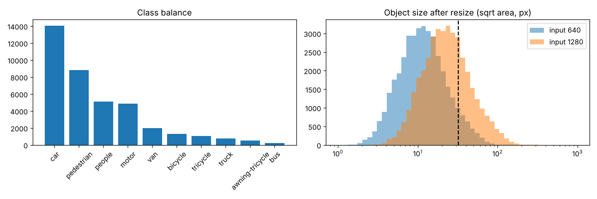
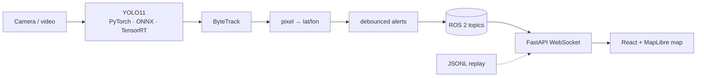

# Edge AI for Real-Time Situational Awareness from Drones

Detection and tracking of **people and vehicles from drone video**, built for embedded deployment
(NVIDIA Jetson), with every number measured on public data and every limitation written down.

> 🎬 **Demo video (60 s):** attached to the [v0.1 release](../../releases). Rendered from real outputs only by `docs/video/make_video.py`.



> **Status (October 2026):** Phase 1 done on CPU — data analysis, baselines, resolution and
> sliced-inference experiments, a first fine-tune, and detection on held-out footage.
> **Next:** a full fine-tune on GPU, tracking and the live map on continuous drone video, TensorRT FP16/INT8 on a Jetson Orin Nano (speed, watts, joules per frame) and maritime
> search-and-rescue data (SeaDronesSee). Tables for those are below, empty until measured.

## The problem, in one table

Drone footage makes objects tiny. On the VisDrone validation set (548 images, 38,759 labelled objects):

| model input | median object size | under 16 px | "small" (< 32 px, COCO definition) |
|---|---|---|---|
| 640 px (YOLO default) | **11 px** | **70%** | **92%** |
| 1280 px | 22 px | 31% | 70% |

So the metric that matters is **AP on small objects**, not headline mAP.

## Results so far (measured, CPU)

All rows: VisDrone2019-DET **val**, 548 images, classes mapped to person / two-wheeler / vehicle,
COCO-style AP at IoU 0.50:0.95, maxDets 500. Time = median end-to-end ms per image on a
**2-vCPU cloud VM without GPU** — useful for comparing rows, not representative of a Jetson.

| model | weights | input | slicing | AP50 | AP | **AP_small** | AP_large | CPU ms/img |
|---|---|---|---|---|---|---|---|---|
| YOLO11n | COCO | 640 | — | 0.200 | 0.108 | 0.041 | 0.576 | 86 |
| YOLO11s | COCO | 640 | — | 0.280 | 0.153 | 0.075 | 0.685 | 200 |
| YOLO11n | COCO | 1280 | — | 0.356 | 0.198 | 0.124 | 0.684 | 317 |
| YOLO11s | COCO | 1280 | — | 0.433 | 0.244 | 0.164 | 0.750 | 634 |
| YOLO11n | COCO | 640 | SAHI, 640 px tiles | 0.344 | 0.180 | 0.110 | 0.594 | 882 |
| YOLO11n | fine-tuned, 1 epoch | 640 | — | 0.266 | 0.132 | 0.057 | 0.435 | 79 |
| YOLO11n | fine-tuned, 2 epochs | 640 | — | 0.316 | 0.161 | 0.079 | 0.483 | 80 |
| YOLO11n | fine-tuned, 2 epochs | 1280 | — | 0.448 | 0.238 | **0.169** | 0.354 | 319 |

What the data says:

1. **Off-the-shelf detectors miss most small objects in drone views.** COCO-pretrained YOLO11n gets
   AP 0.58 on large objects but **0.04** on small ones.
2. **Resolution beats model size.** YOLO11n at 1280 (AP_small 0.124, 317 ms) beats YOLO11s at 640
   (0.075, 200 ms).
3. **Sliced inference (SAHI) is not free.** It nearly triples AP_small for YOLO11n (0.041 → 0.110) but
   takes 882 ms per image; plain 1280 inference does better in a third of the time on these images.
4. **A short fine-tune on drone data matters most.** Two CPU epochs on the VisDrone training set took
   YOLO11n's AP_small from 0.041 to 0.079 at 640, and to **0.169 at 1280** — four times the starting point,
   and slightly ahead of the larger pretrained YOLO11s at 1280 (0.164) in half the time (319 vs 634 ms).
   Large-object AP fell (0.58 → 0.35–0.48) as the model adapted to the drone domain; a longer run on a GPU
   should recover it. On 21 held-out frames it found 422 of 836 labelled objects (50%, IoU ≥ 0.5, confidence 0.25).

### On the Jetson (next)

Jetson Orin Nano, JetPack 6, fixed power mode, clocks locked. Produced by `benchmarks/benchmark.py`.

| model | input | precision | AP_small | FPS | p50 ms | p99 ms | W | J/frame | max °C |
|---|---|---|---|---|---|---|---|---|---|
| YOLO11n fine-tuned | 640 | FP16 | | | | | | | |
| YOLO11n fine-tuned | 640 | INT8 | | | | | | | |
| YOLO11n fine-tuned | 1280 | FP16 | | | | | | | |

## System



Details: [docs/architecture.md](docs/architecture.md).

## Reproduce

```bash
pip install -r requirements-train.txt && pip install -e . && pytest -q

# data (VisDrone2019-DET train + val from the VisDrone project)
python data/convert_visdrone.py --src /path/to/visdrone --out datasets/visdrone_yolo
python data/analyse_dataset.py --data configs/datasets/visdrone.yaml --split val --imgsz 640 1280

# baselines and experiments (rows appended to benchmarks/results/zeroshot.csv)
python training/evaluate_zeroshot.py --model yolo11n.pt --data configs/datasets/visdrone.yaml --imgsz 640 --tag y11n_640
python training/evaluate_zeroshot.py --model yolo11n.pt --data configs/datasets/visdrone.yaml --imgsz 640 --sahi --tag y11n_640_sahi640

# fine-tune (held-out sequences 9999951 and 9999955 moved out of train first; see docs/EXPERIMENT_LOG.md)
python training/train.py configs/train/vis_y11n_640_cpu.yaml
python training/evaluate_zeroshot.py --model runs/vis/y11n_640_cpu_3ep/weights/last.pt  # results above use the epoch-2 checkpoint --class-map visdrone \
    --data configs/datasets/visdrone.yaml --imgsz 640 --tag ft_y11n_640

# tracking + map demo, no ROS needed
python tools/detect_video.py --model <weights> --source <continuous video.mp4> --out outputs/demo_track.jsonl
# (use --no-track for frames that are seconds apart, like VisDrone-DET sequences)
python web/backend/server.py --replay outputs/demo_track.jsonl
cd web/frontend && npm install && npm run dev
```

The full step-by-step course, with the reasoning behind each step: [docs/LAB_GUIDE.md](docs/LAB_GUIDE.md).

## Repository layout

```
data/          dataset converters, COCO ground-truth builder, dataset analysis
training/      train.py (config-driven), evaluate_zeroshot.py, evaluate_coco.py (AP_small, SAHI)
configs/       one YAML per experiment
export/        ONNX + TensorRT export (TensorRT: run on the Jetson)
benchmarks/    latency / power / accuracy benchmark, results CSVs, table generator
tools/         detect_video.py: detection + tracking + geolocation without ROS
ros2_ws/       ROS 2 Humble package (detector node, launch file)
web/           FastAPI WebSocket bridge + React/MapLibre map
src/esa/       shared code: geolocation, alerts, tegrastats reader, COCO evaluation
docs/          lab guide, experiment log, limitations, model cards, demo-video renderer
tests/         unit tests
```

## Data

| dataset | used for | terms | citation |
|---|---|---|---|
| VisDrone2019-DET | land: people, vehicles | Research benchmark; the project's GitHub page states no formal licence (checked 2026-10-09). Treated as research-only. | Zhu et al., "Detection and Tracking Meet Drones Challenge", IEEE TPAMI 44(11), 2021 |
| SeaDronesSee (planned) | sea: swimmers, boats | *to be recorded on download* | Varga et al., WACV 2022 |

No raw data is stored in this repository. Check each dataset's current terms before use.

## Limitations

Measured so far on CPU only; Jetson numbers pending. Trained briefly on one public dataset.
Geolocation assumes a straight-down camera over flat ground at a known (here simulated) position.
Not for operational use. Full list: [docs/LIMITATIONS.md](docs/LIMITATIONS.md).

## Independence

Built on personal hardware and cloud resources, in personal time, using only public datasets and
open-source software. No code, data or know-how from any employer or government work was used.

## Licence

AGPL-3.0, as required by Ultralytics YOLO. Dataset terms apply separately.
