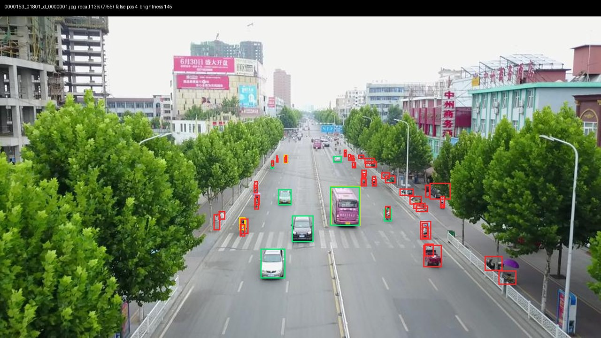
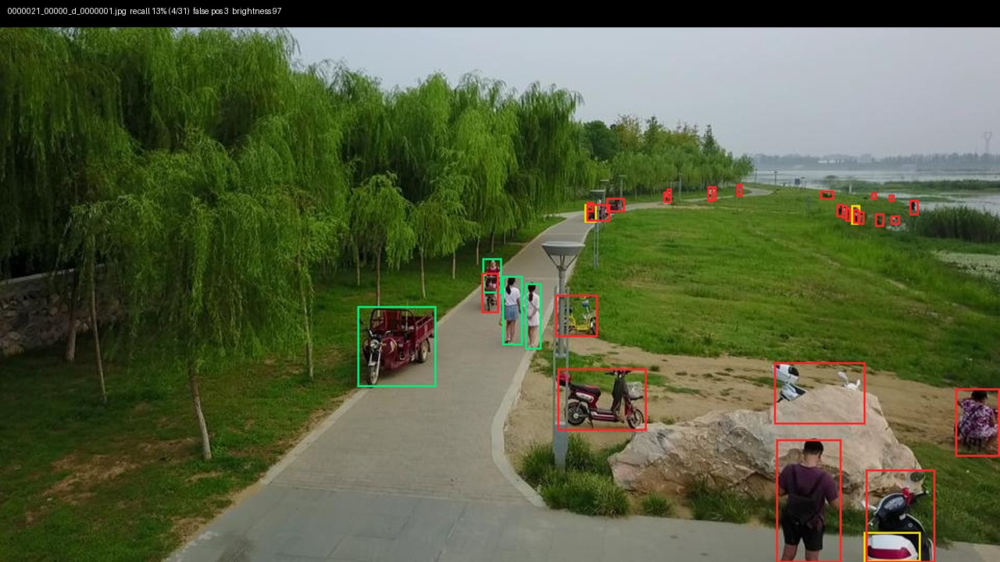
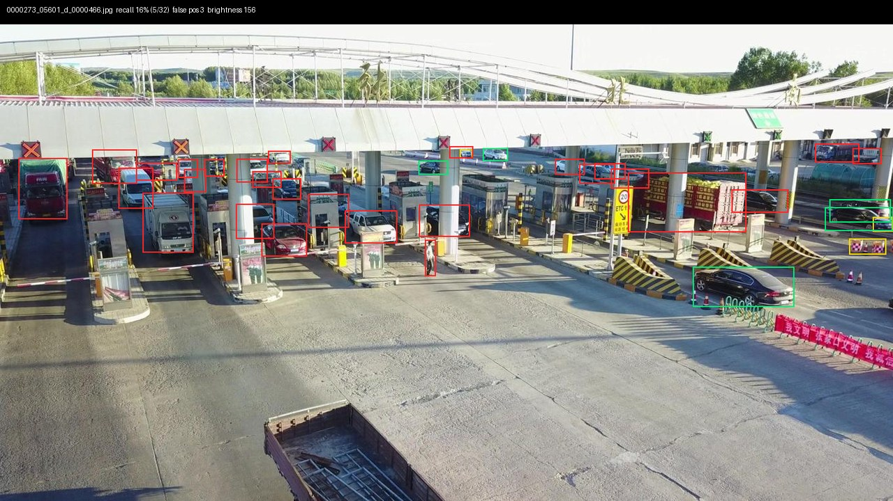
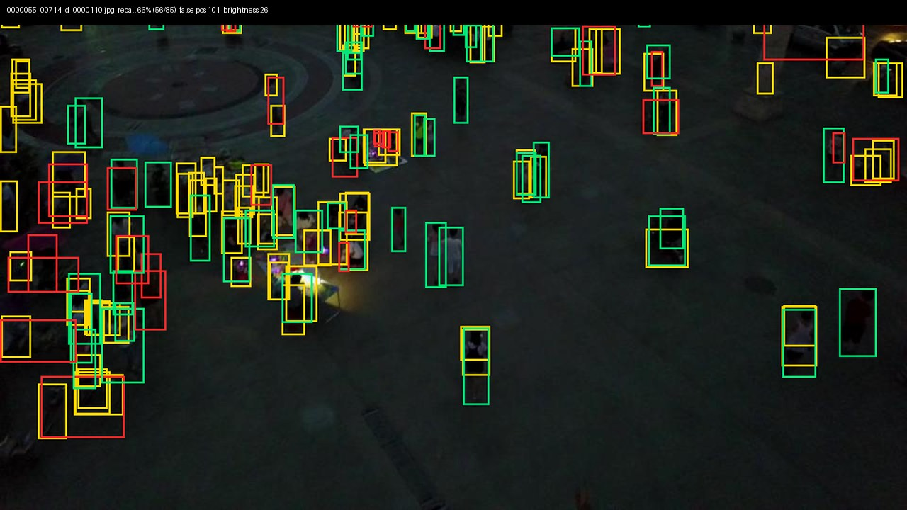

# Limitations

What this project does not show yet, and where the model fails. Every failure below was measured
(`data/failure_analysis.py`, `benchmarks/geo_sensitivity.py`) or seen in the annotated images.

## Scope of the measurements

- **CPU only so far.** All speeds come from a 2-vCPU cloud VM without a GPU; repeated runs vary by about ±10%.
  They compare configurations; they are not Jetson performance. The Jetson table is still empty.
- **Training.** The shipped sea and thermal models and the land model were trained for 60-120 epochs on a free Kaggle
  GPU (docs/KAGGLE.md); several analyses (failure analysis §6, INT8 §5, tracking §3 and §9, search planning §10, text
  prompts §12) were measured with the earlier 3-5 epoch CPU models and have not been re-run. Life-saving appliances
  (the smallest sea class) are still essentially not detected (AP 0.019). Only YOLO11n has been trained; larger models
  and YOLO26 are untested.
- **Thermal person/car confusion above 120 m.** The GPU thermal model labels most people as *car* in one held-out
  group at 130 m at night (126 of 137). Inside the 115 m flight envelope it is better than the earlier model; above
  it, it is not fit for a person search (README §10b).
- **Two datasets, both small slices.** Land: VisDrone (Chinese cities). Sea: a 2,500-image training subset of
  SeaDronesSee (lakes and the North Sea, summer, mostly DJI cameras), images downscaled from 4K to 1920 px.
  Performance in Nordic winter, rough seas, at night or with thermal cameras is unknown.
- **SeaDronesSee 'ignored' regions** are dropped from the labels, so detections inside them count as false positives.
- **Ten classes mapped to three** (person / two-wheeler / vehicle) so pretrained and fine-tuned models can be
  compared. Tricycles are left out of that ground truth.
- **Real tracking: four short sea clips only** (5–10 s each, slow camera motion). The fast-camera result (motion
  compensation matters) still comes only from the controlled simulation over one still, labelled frame; no real
  footage with fast camera motion and identity labels has been tested yet.
- **ROS 2 tested in CI, not on the Jetson.** The node builds and runs end to end on ROS 2 Humble (GitHub runner,
  CPU, sample images); it has not yet run on the Jetson with a camera. Live telemetry is tested with simulated
  topics, not a real autopilot; gimbal yaw is assumed equal to the airframe heading, and there is no time
  synchronisation between a frame and the telemetry beyond "latest value, at most 1 s old".
- **Demo footage is held out, not foreign.** Sequences 9999951 and 9999955 were removed before training, but
  other VisDrone sequences may show the same city.
- **Not a safety-certified system.** Research software, not for operational rescue use.

## Geolocation

The pipeline now models gimbal pitch and heading (ray / flat-surface intersection). Remaining limits:

- **Attitude telemetry decides accuracy.** On real footage the tilt-aware model fixed the big error on a very oblique
  clip, but was worse than the straight-down model on a clip where the drone accelerated sideways while turning: the
  logged heading did not match the scene's rotation in the image, and objects ~50 m ahead magnify attitude errors.
  Needs frame-rate, timestamped gimbal attitude (or yaw estimated from the image).
- **Field of view assumed** (65.5° for the SeaDronesSee DJI clips); no lens distortion; no camera roll; flat surface
  (exact at sea, approximate over land); box centre used as the object's position.
- **No ground-truth object positions** exist for real footage, so the real-data test uses a physical plausibility check
  (swimmers move ≲ 1 m/s), not measured error in metres.

Measured effect of each error source in the controlled simulation (drone at 57–69 m, 70° lens, median over
7,634 objects; this table motivated the tilt-aware model):

| assumption broken | error |
|---|---|
| GPS off by 5 m | 5.0 m |
| altitude reading 10% high | 2.9 m |
| compass off by 5° | 2.5 m |
| **gimbal tilted 10°, treated as straight down** | **11.8 m** |
| gimbal tilted 20° | 24.2 m |

The ray intersection is now implemented (`src/esa/geo.py`); terrain is not.

## Search planning, alerts and TAK (v2)

- **Search planning is a model built on measurements, not a field trial.** It assumes calm water, daylight, a camera
  pointing straight down, a fixed visible swimmer size per scenario, and detection that is uniform across the frame.
  Nothing has been flown with it yet.
- **False alarms are not in the plan.** The model produces about 1 false swimmer box per image at the operating point.
  At 100 m each frame covers more sea, so the false-alarm rate per km² is unknown. It needs measuring before
  recommending an altitude for real use.
- **Independent-look estimates come from 4 short clips** filmed from a slowly moving drone. Looks during a real sweep are
  probably less correlated, so POD is likely underestimated (the conservative direction).
- **No data below 4 px** at the model input. Altitudes that would make a swimmer smaller than that are shown as
  "beyond measured data", not predicted.
- **Alert de-duplication radius (3 m) was chosen on the same 4 clips it was measured on.** Swimmers closer together than
  3 m share one alert.
- **TAK:** UDP and plain TCP only; no TLS / client certificates (port 8089), no data packages, no CoT acknowledgement.
  Tested against an open-source TAK server (taky) in CI, not against ATAK on a phone in the field.
- **Operator decisions are not authenticated**; anyone who can reach the ground-station WebSocket can confirm or reject.

## Observed failures

Green = found, red = missed, yellow = false positive. Fine-tuned YOLO11n, 1280 px, confidence 0.25.

### Tiny objects: under 8 px, 1 in 10 is found
Recall by object size at model input: 10% (< 8 px), 26% (8–16), 49% (16–32), 73% (32–64), 87% (≥ 64).
Likely fix: train at 1280 px (training here was at 640), a P2 detection head for small strides, or tiling on 4K input.

### Low, oblique view down a long road: recall 13%

Most of the 55 objects sit far down the road and shrink to a few pixels; only the nearest cars are found.
Likely cause: perspective makes object size vary with distance far more than in near-vertical views.

### Near-ground view: large, close objects missed, recall 13%

People and scooters close to the camera are missed even though they are large. This matches the drop in
large-object AP after fine-tuning (0.58 → 0.38): three short epochs on mostly high-altitude imagery made the
model forget how close-up objects look. Likely fix: longer training, keep some close-range data in the mix.

### Dense, occluded scene (toll plaza): recall 16%

Vehicles packed under a canopy and partly hidden by booths. Over the whole val set, recall is 63% for
unoccluded objects, 42% partially occluded, 23% heavily occluded.

### Night: the model invents objects

On 17 dusk/night images recall holds (48.7% vs 49.5% in daylight) but precision falls from 70% to 44%:
duplicate boxes on the same person and boxes on dark blobs. 101 false positives in this one image. Likely fix:
more night training data, a thermal camera, or a higher confidence threshold at night.

### Two-wheelers and people
Recall: vehicles 74%, people 34%, two-wheelers 23%. People and bikes are smaller and more often occluded.
