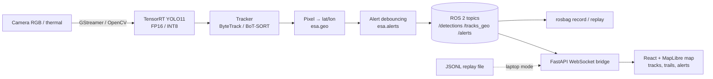

# Architecture

Offline side: public datasets → `data/convert_*.py` → YOLO format → `training/train.py` → `training/evaluate_coco.py` (validation) → chosen model → `export/export_trt.py` on the Jetson → `benchmarks/benchmark.py`.
